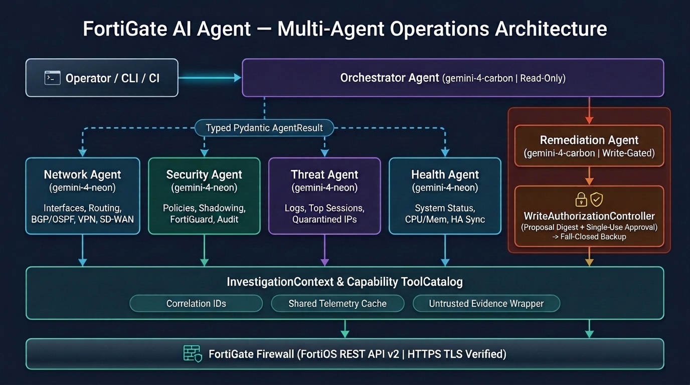
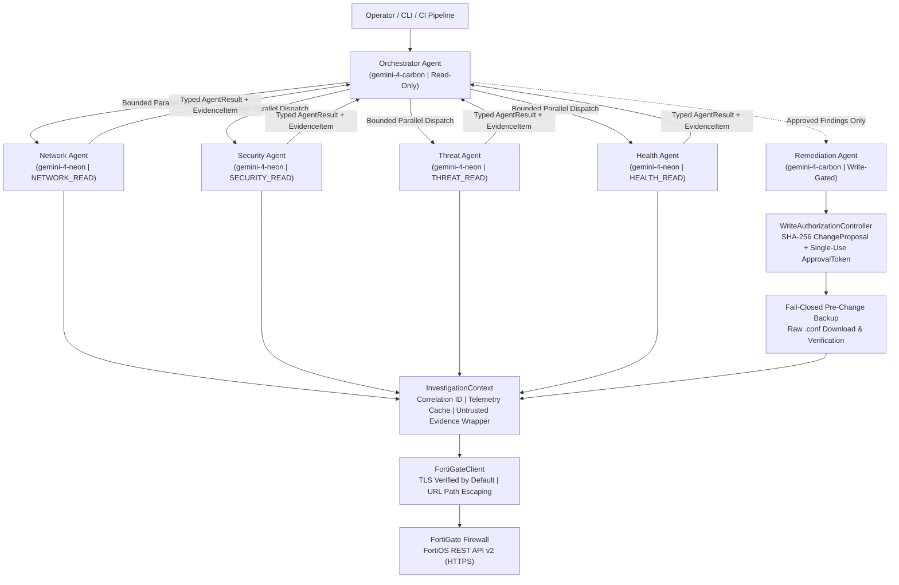
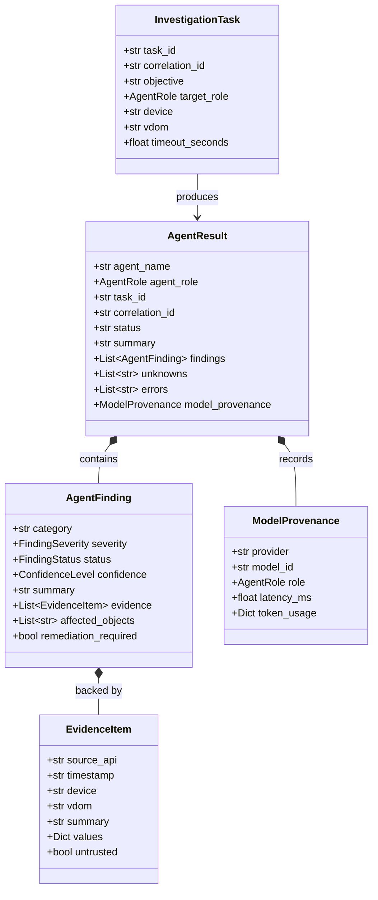
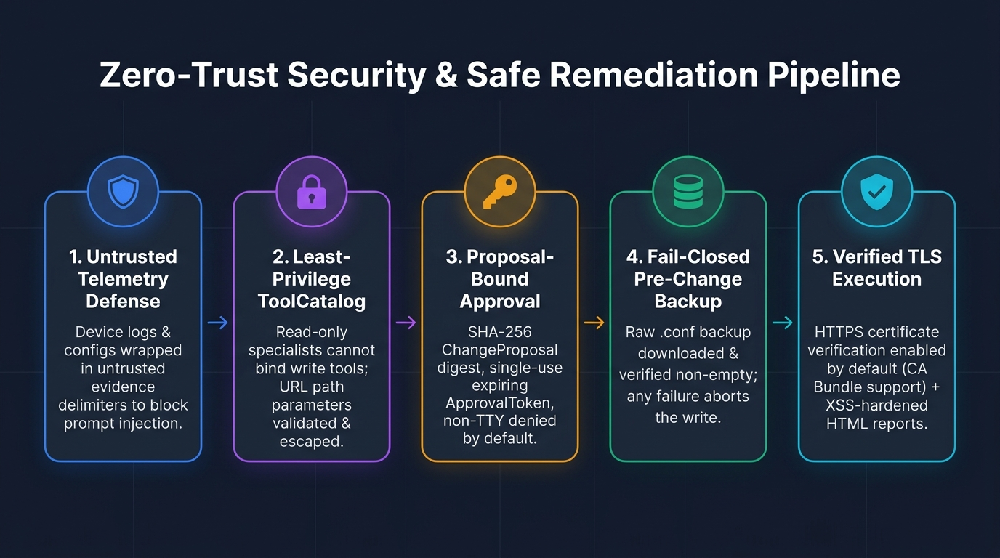
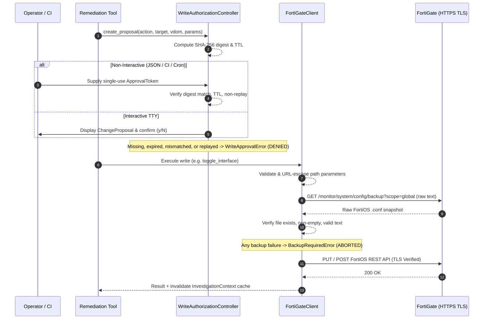

# FortiGate AI Operations & Diagnostics Agent

A production-ready AI operations and troubleshooting agent written in Python that interfaces directly with FortiGate firewalls running FortiOS (v7.0+) using the modern **`google-genai`** SDK. The agent is equipped with 26 custom function-calling tools that enable it to dynamically retrieve, inspect, correlate, audit, and remediate network configurations, resource utilization, interfaces, active session tables (top talkers), SD-WAN health metrics, VPN tunnels, dynamic routing adjacencies (BGP & OSPF), ARP tables, DHCP leases, FortiGuard security subscriptions (AV/IPS/WebFilter), quarantined threat actors, firewall security policies, policy shadowing conflicts, system configuration backups, and event logs.

It provides six operational modes:
1. **Automated Diagnostics**: Gathers operational metrics across all subsystems, passes them to the AI agent, and generates a structured markdown-based health assessment and troubleshooting plan.
2. **Interactive Console**: A stateful chat session where you can ask arbitrary questions about the FortiGate, and the AI agent autonomously decides which API tools to invoke in the background.
3. **Autonomous Agentic Call**: Multi-step chain-of-thought call loop where the AI agent autonomously executes tool calls, inspects findings, triggers follow-up telemetry (e.g. log queries or firewall policy inspections), and prints a live reasoning trace of all tools called.
4. **Security Posture & CIS Hardening Benchmark**: Comprehensive multi-domain security audit computing a quantitative Security Health Score (0-100), letter grade (A+ through F), policy shadowing / precedence conflict detection, management interface exposure auditing, and automated FortiOS CLI hardening playbook export (`.conf`).
5. **Configuration Backup**: Generates an immediate full system configuration snapshot (`.conf`) for disaster recovery and change auditing.
6. **Configuration Inspector**: Displays active environment variables, target VDOM, SSL verification modes, and Gemini model settings.

It also features a high-fidelity **Mock Mode** for offline testing and demonstration purposes without requiring a physical or virtual FortiGate appliance.

---

## Multi-Agent Operations Architecture

`fortigate-ai-agent` is evolving into a coordinated **multi-agent FortiGate Network Operations & Security platform** (Issue #16). Instead of a single unconstrained LLM calling arbitrary APIs, specialist agents operate with **least-privilege, read-only tool scopes**, exchange **typed Pydantic evidence contracts**, and share a per-investigation telemetry cache, while all write actions remain strictly isolated behind a deterministic security control plane.



### System Flow & Capability Isolation



### Structured Agent Contracts (Phase 1 Foundation)

All specialist agents communicate via validated Pydantic schemas in `core/schemas.py`, ensuring evidence provenance, explicit `unknown` / `unavailable` / `not_applicable` states, and reproducible model provenance:



---

## Zero-Trust Security Control Plane

Every telemetry read and configuration write passes through deterministic security controls enforced **outside the LLM**:



| Control Layer | Implementation | Protection |
| :--- | :--- | :--- |
| **1. Untrusted Telemetry Defense** | `wrap_untrusted_tool_output()` in `agent.py` | Wraps all FortiGate logs, policy names, comments, and descriptions in explicit `<<<BEGIN_UNTRUSTED_FORTIGATE_EVIDENCE>>>` delimiters and neutralizes boundary spoofing to block indirect prompt injection. |
| **2. Least-Privilege ToolCatalog** | `tools/registry.py` + `core/agent_base.py` | Diagnostic specialists and the Orchestrator are structurally forbidden from binding `REMEDIATION_WRITE` tools. URL path parameters are validated and percent-encoded against path traversal. |
| **3. Proposal-Bound Approval** | `write_authorization.py` | Centralizes write authorization with SHA-256 `ChangeProposal` digests and single-use, expiring `ApprovalToken`s. Non-interactive (JSON/CI/cron) writes are **denied by default** without an exact approval token. |
| **4. Fail-Closed Pre-Change Backup** | `FortiGateClient._execute_write_prechecks()` | Downloads raw plain-text `.conf` from `/monitor/system/config/backup` and verifies the file exists, is non-empty, and is valid before any write. Any backup failure aborts the write with `BackupRequiredError`. |
| **5. Verified TLS & XSS-Hardened Reports** | `config.py`, `fortigate_client.py`, `main.py` | Enables `VERIFY_SSL=True` by default (supports custom `CA_BUNDLE`; explicit `--insecure` emits prominent warning). HTML report exports escape all untrusted fields and pin `marked@12.0.2` + `dompurify@3.0.9` with SHA-384 SRI hashes. |

### Safe Write & Fail-Closed Backup Sequence



---

## Architecture & Endpoints Used

The agent communicates with the standard FortiOS REST API (`/api/v2`) and implements automatic fallback endpoints for multi-version compatibility:

- **System Status**: `GET /api/v2/monitor/system/status` (falls back to `GET /api/v2/cmdb/system/global` if restricted)
- **HA Cluster & Sync**: `GET /api/v2/monitor/system/ha-checksum` (falls back to `GET /api/v2/monitor/system/ha`)
- **System Resources**: `GET /api/v2/monitor/system/resource/usage` (falls back to `GET /api/v2/monitor/system/resource`)
- **Active Firewall Sessions & Top Talkers**: `GET /api/v2/monitor/firewall/session` (live traffic flows, top source/dest IPs, port distribution, bandwidth metrics)
- **Network Interfaces**: `GET /api/v2/monitor/system/interface` (status, speed, duplex, IP, and traffic counts)
- **Interface State Modification**: `PUT /api/v2/cmdb/system/interface/{interface_name}` (administrative up/down toggle)
- **SD-WAN Link Health**: `GET /api/v2/monitor/virtual-wan/health-check` (falls back to `GET /api/v2/monitor/virtual-wan/members` for SLA metrics, latency, jitter, and packet loss)
- **VPN Tunnels**: `GET /api/v2/monitor/vpn/ipsec` and `GET /api/v2/monitor/vpn/ssl` (IPsec tunnel status and SSL-VPN active user sessions)
- **IPsec Tunnel Reset**: `POST /api/v2/monitor/vpn/ipsec/tunnel_reset_stats` (forces Phase 1 re-negotiation)
- **SSL-VPN Disconnect**: `POST /api/v2/monitor/vpn/ssl/disconnect` (active user session termination)
- **Routing Table**: `GET /api/v2/monitor/router/ipv4` (active IPv4 routing table entries)
- **Static Route Creation**: `POST /api/v2/cmdb/router/static` (adds static IPv4 route entry)
- **BGP Dynamic Routing**: `GET /api/v2/monitor/router/bgp/neighbors` (BGP peer status, uptime, route counts)
- **OSPF Dynamic Routing**: `GET /api/v2/monitor/router/ospf/neighbors` (falls back to `GET /api/v2/monitor/router/ospf`)
- **Firewall Policies**: `GET /api/v2/cmdb/firewall/policy` (inspects configured security rules)
- **Firewall Policy Toggle**: `PUT /api/v2/cmdb/firewall/policy/{policy_id}` (enable or disable specific policies)
- **FortiGuard Subscriptions**: `GET /api/v2/monitor/system/fortiguard` (falls back to `GET /api/v2/cmdb/system/fortiguard` for AV, IPS, Web Filter, and signature engine levels)
- **Quarantined / Banned IPs**: `GET /api/v2/monitor/user/banned` (active banned hosts table)
- **IP Quarantine / Ban**: `POST /api/v2/monitor/user/banned/add` (immediate threat containment)
- **Virtual Domains (VDOMs)**: `GET /api/v2/cmdb/system/vdom` (configured VDOM partitions)
- **ARP Table**: `GET /api/v2/monitor/network/arp` (falls back to `GET /api/v2/monitor/system/arp` for Layer 2 MAC mappings)
- **DHCP Leases**: `GET /api/v2/monitor/system/dhcp` (falls back to `GET /api/v2/monitor/system/dhcp/status` for active IP allocations)
- **Configuration Backup**: `GET /api/v2/monitor/system/config/backup` (full system configuration snapshot)
- **Event Logs**: `GET /api/v2/monitor/log/memory/messages` (falls back to `GET /api/v2/monitor/log/disk/messages` and `GET /api/v2/monitor/log/current`)

For authentication, the client utilizes the secure **`Authorization: Bearer <API-TOKEN>`** HTTP header conforming to modern FortiOS standards (v7.2.x, v7.4.x, v7.6.x+).

---

## AI Agent Tools Reference (Function Calling)

The AI Agent exposes 26 Python function-calling tools (`FORTIGATE_TOOLS`) registered directly with the Gemini model via the modern `google-genai` SDK. In interactive or agentic modes, the model autonomously analyzes user queries, selects appropriate tools, executes them, and synthesizes operational findings.

### 1. Read-Only Telemetry, Audit & Inspection Tools (18 Tools)

| Tool Name | Parameters | Description / Telemetry Gathered |
| :--- | :--- | :--- |
| **`run_security_audit`** | _None_ | Executes full FortiOS Security Posture & CIS Hardening Benchmark Audit, computing the 0-100 score, letter grade (A-F), policy shadowing conflicts, and automated CLI hardening playbook. |
| **`get_system_status`** | _None_ | Retrieves hostname, firmware version, build number, serial number, uptime, HA cluster role, and operation mode. |
| **`get_system_resources`** | _None_ | Retrieves CPU utilization (%), memory usage (%), active and maximum concurrent sessions, and disk usage. |
| **`get_top_sessions`** | `limit` (int, default: `10`), `sort_by` (str, default: `"bytes"`) | Retrieves active firewall session table entries, sorted by bandwidth consumption (`bytes`), packets, or duration, plus top talker sources/destinations. |
| **`get_interfaces`** | _None_ | Inspects network interfaces: administrative and physical link status (up/down), IP assignments, speed, duplex, and Rx/Tx byte/packet counters. |
| **`get_vpn_status`** | _None_ | Gathers IPsec Phase 1/Phase 2 tunnel states, remote gateways, throughput, and active SSL-VPN user sessions (username, source IP, duration, bytes). |
| **`get_routing_table`** | _None_ | Retrieves active IPv4 routing table entries, next-hop gateways, egress interface names, administrative distances, and route types (static, connected, dynamic). |
| **`get_arp_table`** | _None_ | Retrieves IPv4 ARP table mappings (IP, MAC, interface, state) to verify Layer 2 neighbor resolution and reachability. |
| **`get_dhcp_leases`** | _None_ | Retrieves active DHCP client lease assignments (IP, MAC, hostname, interface, expiration) to troubleshoot client addressing. |
| **`get_fortiguard_status`** | _None_ | Retrieves FortiGuard subscription licenses, AV/IPS database versions, Web Filter status, and signature expiration dates. |
| **`get_quarantined_ips`** | _None_ | Retrieves the list of currently banned/quarantined IP addresses, ban reasons, and expiration timers from the FortiGate user ban table. |
| **`get_system_logs`** | `log_type` (str, default: `"event"`), `limit` (int, default: `15`) | Fetches recent event, traffic, or security log entries with timestamps, severity levels (warning, info, notice), subtypes, and messages. |
| **`get_bgp_neighbors`** | _None_ | Checks BGP dynamic routing peer states (`Established`, `Active`, `Idle`), remote AS numbers, uptime, and advertised/received route counts. |
| **`get_ospf_neighbors`** | _None_ | Checks OSPF dynamic routing neighbor states (`Full`, `Init`, `Attempt`, `Down`), neighbor router IDs, priorities, and interfaces. |
| **`get_firewall_policies`** | _None_ | Audits configured firewall security policies, rule IDs, source/destination interfaces, addresses, actions (`accept`/`deny`), services, and administrative status. |
| **`get_sdwan_status`** | _None_ | Checks SD-WAN member health, packet loss (%), latency (ms), jitter (ms), and SLA status (`pass`/`fail`). |
| **`get_ha_status`** | _None_ | Monitors High Availability (HA) cluster status, peer members, sync state (`in-sync`/out-of-sync), and checksum matches. |
| **`get_vdom_list`** | _None_ | Lists configured Virtual Domains (VDOMs) and cluster partition IDs for multi-tenant deployments. |

### 2. Active Remediation & Write Tools (8 Tools)

> [!NOTE]
> All write tools require `ENABLE_WRITE_ACTIONS=True` (or `--enable-write` CLI flag) and an API token with read-write permissions. In interactive terminal sessions, the agent will always request explicit confirmation (`y/N`) before modifying any configuration. When `DRY_RUN=True` or `--dry-run` is specified, write actions are safely simulated.

| Tool Name | Parameters | Target Remediation Action |
| :--- | :--- | :--- |
| **`backup_configuration`** | `destination_dir` (str, default: `".backups"`) | Downloads and saves a complete timestamped configuration snapshot (.conf) locally. |
| **`apply_policy_hardening`** | `policy_id` (int) | Applies UTM security profiles (AV, IPS, Web Filter, SSL inspection) and session logging directly to a policy via REST API. |
| **`quarantine_ip_address`** | `ip_address` (str), `duration_seconds` (int, default: `3600`), `reason` (str, default: `""`) | Bans and quarantines a malicious or compromised IP address on the FortiGate firewall. |
| **`reset_vpn_tunnel`** | `p1_name` (str) | Flushes and resets an IPsec Phase 1 VPN tunnel to restart IKE/IPsec negotiations. |
| **`toggle_interface`** | `interface_name` (str), `status` (`"up"` \| `"down"`) | Administratively enables (`up`) or disables (`down`) a network interface. |
| **`add_static_route`** | `destination` (str), `gateway` (str), `interface` (str) | Configures a new static IPv4 route on the FortiGate firewall. |
| **`toggle_firewall_policy`** | `policy_id` (int), `status` (`"enable"` \| `"disable"`) | Enables or disables a specific firewall security policy by policy ID. |
| **`disconnect_ssl_vpn_user`** | `username` (str) | Forcefully terminates an active SSL-VPN user session. |


---

## Installation & Setup

### 1. Prerequisites
- Python 3.10 or higher
- A Google Gemini API key (obtain one from [Google AI Studio](https://aistudio.google.com/))

### 2. Set Up Virtual Environment & Dependencies
Clone or navigate to the project directory:
```bash
# Create and activate a Python virtual environment
python3 -m venv venv
source venv/bin/activate  # On Windows: venv\Scripts\activate

# Install required dependencies
pip install -r requirements.txt
```

### 3. Configure the Environment
Copy the configuration template:
```bash
cp .env.template .env
```

Open `.env` and fill in your settings:
```ini
# Gemini API Key (Required for AI Agent operations)
GEMINI_API_KEY=your_gemini_api_key_here
GEMINI_MODEL=gemini-4-neon

# FortiGate Connection Details
# Leave empty to automatically use high-fidelity MOCK MODE
FORTIGATE_IP=192.168.1.99
FORTIGATE_TOKEN=your_fortigate_api_token_here
FORTIGATE_PORT=443
FORTIGATE_VDOM=root
USE_SSL=True
VERIFY_SSL=True
CA_BUNDLE=

# Set to True to force offline mock simulation
MOCK_MODE=False

# Enable active write/mitigation actions (disable for safe read-only mode)
ENABLE_WRITE_ACTIONS=False

# Dry run mode: simulate write actions without executing REST calls
DRY_RUN=False

# Automatically take configuration snapshot backup before executing write actions
BACKUP_BEFORE_WRITE=True
```

### 4. Environment Variables Reference

| Variable | Type | Default | Description |
| :--- | :--- | :--- | :--- |
| `GEMINI_API_KEY` | String | _None_ | Google Gemini API key for AI reasoning. |
| `GEMINI_MODEL` | String | `gemini-4-neon` | Target Gemini model (`gemini-4-carbon`, `gemini-4-neon`, `gemini-4-argon`, `gemini-3.1-pro-preview`). |
| `ORCHESTRATOR_MODEL` | String | `gemini-4-carbon` | Highest-capability flagship reasoning model for multi-agent orchestration and correlation. |
| `SPECIALIST_MODEL` | String | `gemini-4-neon` | Default flagship model for domain specialist agents. |
| `FORTIGATE_IP` | String | `""` | IP address or hostname of the FortiGate firewall. |
| `FORTIGATE_TOKEN` | String | `""` | REST API Access Token generated in FortiOS GUI. |
| `FORTIGATE_PORT` | Integer | `443` | Target API connection port. |
| `FORTIGATE_VDOM` | String | `root` | Target Virtual Domain (VDOM) for API queries. |
| `USE_SSL` | Boolean | `True` | Whether to connect via HTTPS (`True`) or HTTP (`False`). |
| `VERIFY_SSL` | Boolean | `True` | Whether to verify HTTPS SSL certificates (enabled by default; set `False` only for lab troubleshooting). |
| `CA_BUNDLE` | String | `""` | File path to a custom CA certificate bundle (.pem). Enables SSL verification. |
| `MOCK_MODE` | Boolean | `Auto` | If `True` or if IP/Token are omitted, runs offline mock simulation. |
| `ENABLE_WRITE_ACTIONS` | Boolean | `False` | If `True`, enables active configuration modifications (VPN reset, interface toggle, static routes, policy changes). |
| `DRY_RUN` | Boolean | `False` | If `True`, simulates write actions and displays proposed parameters without applying changes. |
| `BACKUP_BEFORE_WRITE` | Boolean | `True` | Fail-closed pre-change safety control: takes and verifies a `.conf` backup before writes, aborting the write if backup fails. Set `False` only to explicitly bypass. |
| `OUTPUT_FILE` | String | `""` | File path to export diagnostic reports (`.html`, `.md`, or `.json`). |

---

## Generating an API Token on FortiGate

If running in Live Mode, generate a REST API Administrator key on your FortiGate:
1. Log into your FortiGate GUI.
2. Navigate to **System > Administrators**.
3. Click **Create New > REST API Admin**.
4. Set a username (e.g., `ai_operator`).
5. Choose an admin profile:
   * **Read-Only**: Suitable for monitoring and diagnostics mode.
   * **Read/Write**: Required if you wish to use active remediation tools (interface toggle, route addition, policy toggle, tunnel reset).
6. Configure **Trusted Hosts** (strongly recommended to restrict access to your administrative workstation).
7. Click **OK**. A dialog will display your **API Key**. Copy it immediately as it will not be displayed again.

---

## Usage

### Interactive Menu Mode
Launch the application without arguments to view the interactive Rich TUI menu:
```bash
python3 main.py
```
This presents 6 options:
1. **Run Automated Diagnostics & Health Report**: Executes a full health assessment.
2. **Enter Interactive Chat Console**: Launches a stateful conversational session with live tool calling.
3. **Run Autonomous Agentic Reasoning Call**: Executes multi-turn reasoning with live tool execution tracing.
4. **Create Configuration Snapshot Backup**: Manually triggers an immediate full configuration backup snapshot.
5. **View Current Configuration Settings**: Displays active settings in a formatted table.
6. **Exit**: Exits the program.

### CLI Direct Commands & Overrides
You can bypass the menu and directly run specific commands or override settings using command-line arguments:

```bash
# General Syntax
python3 main.py [diagnose | interactive | agentic | audit | config | backup] [options]

# Examples:
# 1. Run automated diagnostics and export an executive HTML dashboard report
python3 main.py diagnose --output report.html

# 2. Run FortiOS Security Posture & CIS Hardening Benchmark with automated CLI Playbook export
python3 main.py audit --playbook fortigate_hardening_playbook.conf --output fortigate_audit.html

# 3. Run diagnostics against a live firewall with custom port and VDOM
python3 main.py diagnose --ip 10.0.0.1 --port 8443 --vdom CustomVDOM --verify-ssl

# 4. Launch interactive console in offline Mock Mode
python3 main.py interactive --mock

# 5. Run interactive console with Safety Dry Run mode enabled
python3 main.py interactive --enable-write --dry-run

# 6. Create an immediate configuration backup snapshot
python3 main.py backup

# 7. Run autonomous multi-step agentic call with execution tracing
python3 main.py agentic
```

### Available CLI Options

| Flag | Short | Description |
| :--- | :--- | :--- |
| `command` | _Positional_ | Command to execute: `diagnose`, `interactive`, `agentic`, `audit`, `config`, `backup`. (Default: Interactive Menu). |
| `--json` | `-j` | Output parsed diagnostics or security audit result in raw structured JSON (suppresses banner and TUI prints). |
| `--mock` | `-m` | Force offline Mock Mode (simulated responses). |
| `--playbook` | _None_ | Export automated FortiOS CLI hardening playbook to a file (`.conf`). |
| `--enable-write` | `-w` | Enable active write/mitigation actions (disabled by default for safety). |
| `--dry-run` | `-d` | Simulate write actions safely without modifying firewall configuration. |
| `--output` | `-o` | Export diagnostic or security audit report to a standalone HTML (`.html`), Markdown (`.md`), or JSON (`.json`) file. |
| `--ip` | `-i` | Override the target FortiGate IP address. |
| `--token` | `-t` | Override the FortiGate REST API Access Token. |
| `--port` | `-p` | Override the target connection port (default: `443`). |
| `--vdom` | `-v` | Override target Virtual Domain (default: `"root"`). |
| `--verify-ssl` | `-k` | Enable HTTPS certificate verification (default). |
| `--insecure` | _None_ | Explicitly disable HTTPS TLS certificate verification (lab troubleshooting only; emits warning). |
| `--ca-bundle` | `-c` | Path to custom CA certificate bundle file (enables certificate verification). |
| `--model` | _None_ | Override Gemini model (e.g. `gemini-4-carbon`, `gemini-4-neon`, `gemini-4-argon`, `gemini-3.1-pro-preview`). |
| `--help` | `-h` | Show CLI help message and exit. |

---

## Gemini Model Selection & Precision Advisory

The agent supports selecting different Gemini models based on your operational requirements:
* **Flagship Reasoning (`gemini-4-carbon`)**: Strongest multi-step reasoning model for complex root-cause analysis, security correlation, orchestration, and remediation planning.
* **Frontier Enterprise (`gemini-4-neon`)**: Default flagship model offering frontier accuracy, low fabrication rates, and strong end-to-end tool execution.
* **Efficient Reasoning (`gemini-4-argon`) & Previous Gen (`gemini-3.1-pro-preview`)**: Optional alternatives when optimizing latency or operating in projects without Gemini 4 access.

Override the model via `.env` (`GEMINI_MODEL=gemini-4-carbon`) or CLI flag (`--model gemini-4-carbon`).

---

## Active Mitigation & Safety System

By default, the AI Agent operates in a strictly **Read-Only** monitoring mode to prevent accidental network configuration changes.

### 1. Enabling Write Actions
To allow the agent to execute remediation tools (`reset_vpn_tunnel`, `toggle_interface`, `add_static_route`, `toggle_firewall_policy`, `disconnect_ssl_vpn_user`), enable write actions via `.env`:
```ini
ENABLE_WRITE_ACTIONS=True
```
Or via the CLI flag:
```bash
python3 main.py --enable-write
```

### 2. Proposal-Bound Confirmation & Non-Interactive Safety
* **Interactive Terminal Sessions**: Even if write actions are enabled, `WriteAuthorizationController` generates a structured `ChangeProposal` (action, target, VDOM, current/proposed state, risk, and SHA-256 digest) and **always prompts for explicit confirmation** before executing any write operation.
* **Non-Interactive / JSON / CI / Cron Sessions**: Write actions are **denied by default** (`WriteApprovalError`) in non-TTY execution—`ENABLE_WRITE_ACTIONS=True` alone never authorizes a specific change. Automated pipelines must supply an explicit, unexpired, single-use `ApprovalToken` bound to the exact proposal digest.
* **Fail-Closed Pre-Change Backup**: When `BACKUP_BEFORE_WRITE=True` (default), the client downloads a raw `.conf` snapshot from `/monitor/system/config/backup` and verifies the file exists, is non-empty, and is readable before proceeding. Any backup failure aborts the write with `BackupRequiredError`.

### 3. FortiOS REST API Permission Handling
If write actions are enabled in the agent but your FortiGate API token is restricted to a **Read-Only** profile in FortiOS, the firewall returns `403 Forbidden` errors. The AI agent catches these permission errors, reports them clearly, and generates the exact FortiOS CLI commands for manual execution.

---

## Structured JSON Output & Automation

For automated scripting, monitoring pipelines, SIEM ingest, and alerting (e.g., Slack webhooks, PagerDuty, or cron jobs), run the agent with `--json` / `-j`. This runs silently and outputs a structured JSON object validated against a Pydantic schema (`DiagnosticReport`):

```bash
python3 main.py --json --mock | jq .
```

### Example JSON Output
```json
{
  "hostname": "FG-HQ-Primary",
  "overall_health": "degraded",
  "findings": [
    {
      "category": "interfaces",
      "status": "warning",
      "summary": "Backup WAN interface 'port2' is Down",
      "details": "Interface 'port2' is configured but reports status 'down' (Link Down)."
    },
    {
      "category": "vpn",
      "status": "critical",
      "summary": "VPN tunnel 'Branch-2-VPN' is disconnected",
      "details": "IPsec phase 1/2 are down. Remote gateway: 198.51.100.50. Uptime: 0s."
    }
  ],
  "troubleshooting_steps": [
    "Verify layer 1 physical connection on port2.",
    "Check Pre-Shared Key (PSK) settings for VPN tunnel 'Branch-2-VPN' on FortiGate and remote gateway.",
    "Run CLI command: 'diagnose vpn ike gateway list name Branch-2-VPN'"
  ]
}
```

### Schema Field Enumeration
* `overall_health`: `"healthy"` | `"degraded"` | `"critical"`
* `findings[].category`: `"system"` | `"resources"` | `"interfaces"` | `"vpn"` | `"routing"`
* `findings[].status`: `"ok"` | `"warning"` | `"critical"`
* `troubleshooting_steps`: Array of actionable CLI commands and remediation steps.

---

## Testing & Quality Assurance

The repository includes an automated unit, security, and multi-agent foundation test suite under `tests/` (`47` deterministic unit tests + gated Gemini integration tests).

### Running Tests
```bash
# Run the full test suite with pytest
python3 -m pytest -v

# Or using Python's built-in unittest runner
python3 -m unittest discover -s tests -v
```

### Test Coverage Highlights
* **Phase 1 Multi-Agent Foundation (`tests/test_phase1_foundation.py`)**: Validates Pydantic contracts, least-privilege `ToolCatalog` scoping, shared per-investigation telemetry caching, flagship `ModelRegistry` defaults, provider error fallbacks, and async timeouts.
* **Write Authorization (`tests/test_write_authorization.py`)**: Verifies centralized proposal-bound approvals, non-TTY default denial, TTL expiration, replay prevention, and parameter mismatch rejection.
* **Fail-Closed Backups (`tests/test_backup_fail_closed.py`)**: Tests live plain-text `.conf` backup handling, API/filesystem/empty/corrupt backup aborts, and API token redaction.
* **TLS Verification Defaults (`tests/test_security_tls.py`)**: Asserts `VERIFY_SSL=True` by default, custom CA bundle handling, fast-fail `TLSVerificationError`, and prominent insecure opt-out warnings.
* **Prompt-Injection Defense (`tests/test_prompt_injection.py`)**: Tests adversarial payloads in logs, policy names, comments, and interface descriptions against untrusted-evidence delimiting.
* **URL Path Escaping (`tests/test_url_escaping.py`)**: Blocks path traversal (`../`), query injection (`?vdom=`), and non-integer policy IDs.
* **HTML Export XSS Hardening (`tests/test_html_export.py`)**: Verifies HTML/JSON escaping and pinned SHA-384 SRI CDN scripts.
* **Security Audit & Client Core (`tests/test_security_audit.py`, `tests/test_agent_reasoning.py`, `tests/test_model_config.py`)**: Covers CIS security auditing, policy shadowing, VDOM injection, rate-limit retries, and Gemini 4 model defaults.

---

## Project Structure

```text
.
├── core/
│   ├── agent_base.py            # BaseAgent with least-privilege enforcement & async timeouts
│   ├── context.py               # InvestigationContext (correlation IDs & shared telemetry cache)
│   ├── llm_provider.py          # Provider abstraction (Gemini/Mock) & flagship ModelRegistry
│   └── schemas.py               # Shared Pydantic contracts (AgentResult, AgentFinding, EvidenceItem)
├── tools/
│   ├── registry.py              # Capability-based ToolCatalog with role isolation
│   ├── network_tools.py         # Read-only Network domain tools
│   ├── security_tools.py        # Read-only Security & audit tools
│   ├── threat_tools.py          # Read-only Threat, log, and session tools
│   ├── health_tools.py          # Read-only System/HA health tools
│   └── remediation_tools.py     # Approval-gated write & backup tools
├── docs/
│   └── images/
│       ├── multi_agent_architecture.jpg  # Multi-Agent Operations Architecture diagram
│       └── security_control_plane.jpg    # Zero-Trust Security & Safe Remediation Pipeline diagram
├── write_authorization.py       # Centralized ChangeProposal & single-use ApprovalToken controller
├── agent.py                     # Gemini AI agent integration, untrusted-evidence wrapping & tools
├── config.py                    # Centralized configuration loader (TLS-verified & Gemini 4 defaults)
├── fortigate_client.py          # FortiOS REST API client, fail-closed backups, TLS & path validation
├── main.py                      # CLI driver, TUI menu, and XSS-hardened HTML/JSON/MD report export
├── security_audit.py            # FortiOS Security Posture & CIS Hardening Benchmark Engine
├── requirements.txt             # Python package dependencies
├── .env.template                # Environment variables configuration template
├── Dockerfile                   # Production container image definition
├── docker-compose.yml           # Docker Compose service orchestration
├── fortigate-ai-agent.1         # Linux manual page (man page)
├── tests/                       # Comprehensive unit, security, and multi-agent test suites
└── LICENSE                      # MIT License
```

---

## Containerization & Deployment

You can build and deploy the AI agent inside an isolated Docker container.

### 1. Build and Run via Docker CLI
Build the Docker image:
```bash
docker build -t fortigate-ai-agent .
```

Run a diagnostics check (inheriting local `.env` configuration):
```bash
docker run --rm --env-file .env -v "$(pwd)/fortigate_agent.log:/app/fortigate_agent.log" fortigate-ai-agent diagnose
```

Run silent JSON diagnostics (ideal for cron jobs):
```bash
docker run --rm --env-file .env fortigate-ai-agent --json
```

### 2. Deploy via Docker Compose
```bash
# Build and run the default automated diagnostics
docker-compose up --build

# Run an interactive session in Docker
docker-compose run --rm agent interactive
```

---

## Linux Manual Page (Man Page)

The repository provides a formatted Unix/Linux manual page:
```bash
# View the manual page locally
man ./fortigate-ai-agent.1

# (Optional) Install system-wide
sudo cp fortigate-ai-agent.1 /usr/local/share/man/man1/
sudo mandb
man fortigate-ai-agent
```

---

## Log Auditing & Resilience

All internal API requests, parameters, status codes, and AI tool invocations are recorded to:
`fortigate_agent.log`

This log captures:
* Exact request URLs, parameters, and SSL certificate verification paths.
* Rate-limiting (HTTP 429) events and Tenacity exponential backoff retries.
* AI function-calling reasoning traces and remediation tool executions.

---

## License

This project is licensed under the MIT License. See the LICENSE file for details.


